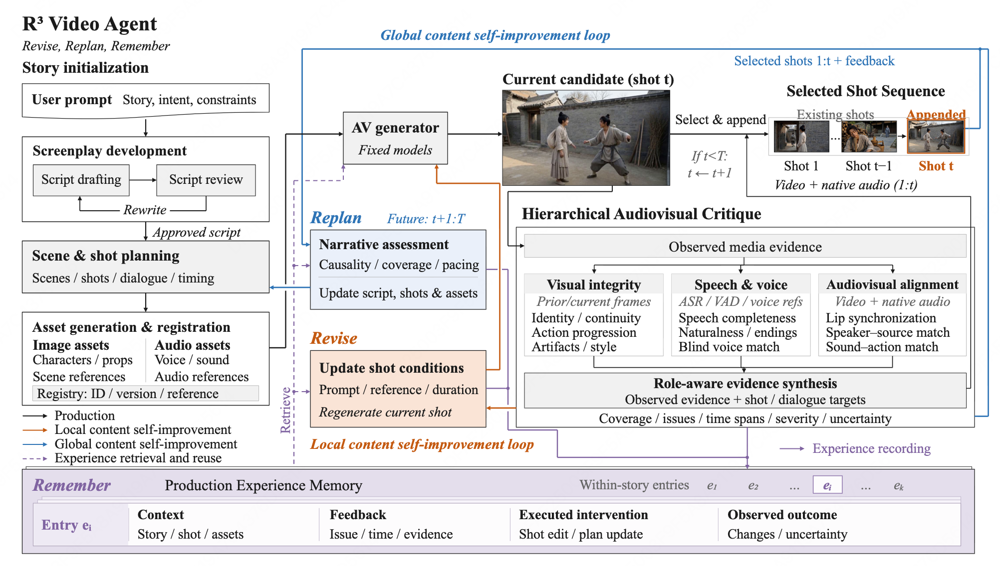

# R³ Video Agent

**Revise, Replan, Remember: An Agentic Harness for Self-Improving Long-Form Audiovisual Storytelling**

[Technical Report](docs/R3_VideoAgent.pdf) · [Project Page](https://chenzhaonju.github.io/R3Agent/)

Give the harness a story, a cast with stable identities, a language and a duration window. It drafts and reviews the screenplay, prepares a shot plan, generates reference assets, then produces and reviews one audiovisual shot at a time. The main outputs are a film with its native soundtrack, an ordered record of the selected takes and a report with unresolved review findings.



The harness uses feedback from generated audio and video to guide production shot by shot. **Revise** adjusts the prompt, references, or duration before regenerating the current shot. **Replan** updates upcoming shots based on the selected sequence. **Remember** records interventions and their outcomes so relevant experience can guide later shots in the same story.

## How the harness makes a film

1. **Plan the story.** The screenwriter and editor check the event order, character motivations, dialogue and ending. The director expands scenes into ordered shots with a duration, speaker assignments, reference requirements and physical render directions. Admission checks cover the frame budget, executable shot fields and registered asset IDs. Chinese and English dialogue are supported.
2. **Build the cast and assets.** A canonical image identifies a character. A change of life stage can use an edit of that image. Each edit binds its parent checksum and uses an independently derived, reproducible seed. Age edits include face conditioning, natural texture review and a limited candidate budget. Speaking characters use a designed calibration voice and can use isolated voice references for cloning. The ASR worker hears the waveform without the expected transcript.
3. **Revise the current shot.** The local planner uses recent selected shots and the current shot target. The generator receives the compiled prompt and its ordered physical references. The visual reviewer inspects silent sampled frames, the audiovisual reviewer inspects the candidate with its native audio, and the decision model grounds a disposition in the observations. A retry consumes a candidate and records what changed in its inputs. The default cap is six takes **including the first**. Unresolved issues can accompany a selected draft.
4. **Replan upcoming shots.** At scheduled checkpoints and on eligible continuity issues the director can revise the uncommitted suffix and propose asset work. The realized prefix summarizes what is visible and audible in the selected media. Changes bind to future targets while committed shots retain their identities. Source events, assigned dialogue and the ending constrain revisions.
5. **Remember outcomes.** The harness stores interventions together with their observed outcomes. Local decisions can retrieve up to three relevant experiences. Requests record the experiences actually included. The default memory scope is one story run.
6. **Assemble and report.** Selected video and native audio are assembled in shot order. The program probes real frame counts, stream geometry, duration and file digests. The report separately records technical delivery and content acceptance. Read any `draft/needs_review` findings before treating the film as editorially approved.

| Component | Entry point |
|---|---|
| CLI and state machine | `lite/__main__.py`, `lite/agent.py`, `lite/storage.py` |
| Planning, duration and reference binding | `lite/director_plan.py`, `lite/duration_budget.py`, `lite/character_stages.py`, `lite/binding_contract.py` |
| Hierarchical critique and revision | `lite/completion_review.py`, `lite/completion_flow.py`, `lite/dialogue_integrity.py` |
| Replanning and experience | `lite/completion_plan.py`, `lite/completion_memory.py`, `lite/memory.py` |
| Provider requests, media workers and assembly | `lite/providers.py`, `lite/media.py`, `lite/audio_assets.py`, `backend/`, `tools/` |

## 1. Install the controller

Use Linux with Python 3.11, FFmpeg and FFprobe on the same PATH. FFmpeg needs H.264, AAC and PCM support. Local generation requires a CUDA installation and a GPU compatible with the selected models. The default H3 profile requires FlashAttention 3. The controller, image, speech, music and video libraries need different dependency sets. Install the worker environments separately.

From the repository root, choose writable locations **outside this checkout** for the installation and story. All destinations below belong to the person running the code.

```bash
export REPO="$PWD"
export INSTALL="$HOME/r3-runtime"
export STORY_WORK="$HOME/r3-stories/brass-key"
mkdir -p "$INSTALL/envs" "$INSTALL/models" "$INSTALL/resources"
python3.11 -m venv "$INSTALL/envs/control"
source "$INSTALL/envs/control/bin/activate"
python -m pip install -r requirements.txt
python -B -m unittest discover -s tests
```

## 2. Install the local models

`tools/configure.py` uses the following layout. Model IDs and public source revisions for the audio models are also listed in [model_sources.json](examples/model_sources.json).

| Purpose | Checkpoint or source | Location under `$INSTALL` |
|---|---|---|
| Character, scene and edited references | [Qwen-Image-2.1](https://huggingface.co/Qwen/Qwen-Image-2.1), Diffusers layout | `models/image` |
| Character voice design | [Qwen3-TTS VoiceDesign, 1.7B](https://huggingface.co/Qwen/Qwen3-TTS-12Hz-1.7B-VoiceDesign) | `models/voice_design` |
| Voice cloning | [Qwen3-TTS Base, 1.7B](https://huggingface.co/Qwen/Qwen3-TTS-12Hz-1.7B-Base) | `models/voice_clone` |
| Instrumental cues (optional in the film; required by the default audio probe) | [ACE-Step 1.5](https://github.com/ace-step/ACE-Step-1.5), turbo DiT, VAE and text embedding | `models/music` and `ACE-Step-1.5` |
| Native video and audio | [MiniMax-H3](https://huggingface.co/MiniMaxAI/MiniMax-H3), [DiffSynth-Studio](https://github.com/modelscope/DiffSynth-Studio) and [matching 8-step adapters](https://huggingface.co/alibaba-pai/MiniMax-H3-Acc-LoRAs) | `models/h3/{Ref2VA,FL2VA}`, `models/adapters` and `DiffSynth-Studio` |
| Blind transcription and speech activity | [Whisper large-v3](https://huggingface.co/openai/whisper-large-v3) and [Silero VAD](https://github.com/snakers4/silero-vad) | `models/asr` and the `envs/asr` environment |

Use a separate download environment for the Hugging Face CLI. The multi-pattern filters below were checked with version 0.36.0. Download each model under its provider's terms. Keep the supplied weight directory structure, tokenizers and configuration files. The Whisper path must contain the single `model.safetensors` expected by preflight.

```bash
python3.11 -m venv "$INSTALL/envs/download"
"$INSTALL/envs/download/bin/python" -m pip install "huggingface_hub==0.36.0"
HF="$INSTALL/envs/download/bin/hf"

"$HF" download Qwen/Qwen-Image-2.1 --revision 790c92633540aa0cb11d9abf19eb46d861714758 --local-dir "$INSTALL/models/image"
"$HF" download Qwen/Qwen3-TTS-12Hz-1.7B-VoiceDesign --revision 5ecdb67327fd37bb2e042aab12ff7391903235d3 --local-dir "$INSTALL/models/voice_design"
"$HF" download Qwen/Qwen3-TTS-12Hz-1.7B-Base --revision fd4b254389122332181a7c3db7f27e918eec64e3 --local-dir "$INSTALL/models/voice_clone"
"$HF" download ACE-Step/Ace-Step1.5 --revision 19671f406d603126926c1b7e2adc169acbcade22 --include 'acestep-v15-turbo/*' 'vae/*' 'Qwen3-Embedding-0.6B/*' --local-dir "$INSTALL/models/music"
"$HF" download openai/whisper-large-v3 --exclude '*.msgpack' '*.bin' '*.h5' 'onnx/*' --local-dir "$INSTALL/models/asr"
"$HF" download MiniMaxAI/MiniMax-H3 --revision 9d710aedb174fa4448fcdeeb9a542f11ab52209a --include 'Ref2VA/*' 'FL2VA/*' --local-dir "$INSTALL/models/h3"
"$HF" download alibaba-pai/MiniMax-H3-Acc-LoRAs MiniMax-H3-Ref2VA-Acc-8Step.safetensors MiniMax-H3-FL2VA-Acc-8Step.safetensors --local-dir "$INSTALL/models/adapters"

git clone https://github.com/modelscope/DiffSynth-Studio "$INSTALL/DiffSynth-Studio"
git -C "$INSTALL/DiffSynth-Studio" checkout 7686e54d41d25c0e8ed5f1318acc23b6bb832654
git clone https://github.com/ace-step/ACE-Step-1.5 "$INSTALL/ACE-Step-1.5"
git -C "$INSTALL/ACE-Step-1.5" checkout ca1e85fe9430179831e6bc6be790c332190a3866
cp "$INSTALL/ACE-Step-1.5/acestep/models/turbo/"{configuration_acestep_v15.py,modeling_acestep_v15_turbo.py} "$INSTALL/models/music/acestep-v15-turbo/"
curl -fL https://raw.githubusercontent.com/MiniMax-AI/MiniMax-H3/199b7d0e1fd95e7b3eafa8c15eca692534142427/skills/h3-prompt-writing/references/ref-en.txt -o "$INSTALL/resources/ref-en.txt"
```

The image and H3 download commands pin the upstream snapshots. The Qwen model index has SHA-256 `cf1ecd104ea090855d60d8cec0895c1e9d6ee41b2f87e231b678beecd1cf7809`. The final download is the upstream full-reference prompt guide used by the director. Workspace setup verifies its SHA-256. The two H3 adapter digests in [h3.example.yaml](examples/h3.example.yaml) match the respective published files.

**Worker environments.** Create the four interpreters below. Install CUDA-enabled PyTorch builds compatible with the local driver before installing model libraries. A supported Linux driver, system audio codecs and sufficient GPU memory are needed for real inference. The model projects document platform-specific installation details.

```bash
python3.10 -m venv "$INSTALL/envs/image"
python3.11 -m venv "$INSTALL/envs/audio"
python3.10 -m venv "$INSTALL/envs/asr"
python3.10 -m venv "$INSTALL/envs/video"
# For image, ASR and H3, the reference software combination uses torch 2.6.0 and CUDA 12.4.
for worker in image asr video; do
  "$INSTALL/envs/$worker/bin/python" -m pip install torch==2.6.0 torchvision==0.21.0 torchaudio==2.6.0 --index-url https://download.pytorch.org/whl/cu124
done
"$INSTALL/envs/image/bin/python" -m pip install 'numpy<2' Pillow opencv-python-headless==4.9.0.80 accelerate transformers==5.17.0 'git+https://github.com/huggingface/diffusers@c2798cc7859f258c6cfc5b2460e82b6cac71f235'
"$INSTALL/envs/asr/bin/python" -m pip install transformers==5.17.0 soundfile silero-vad==5.1.2
"$INSTALL/envs/video/bin/python" -m pip install -e "$INSTALL/DiffSynth-Studio" av==12.0.0 soundfile imageio imageio-ffmpeg
```

Install the FlashAttention **3** Hopper extension into `envs/video` using the [upstream build instructions](https://github.com/Dao-AILab/flash-attention/tree/main/hopper). Check the actual runtime with:

```bash
"$INSTALL/envs/video/bin/python" -c 'from diffsynth.pipelines.minimax_h3_audio_video import MiniMaxH3Pipeline; from diffsynth.utils.data.audio_video import write_video_audio; from diffsynth.core.attention import attention; assert attention.FLASH_ATTN_3_AVAILABLE'
"$INSTALL/envs/image/bin/python" -c 'from diffusers import QwenImage21Pipeline; import cv2'
```

Use `envs/audio` for both local TTS and music. Follow the pinned ACE-Step checkout's [Linux installation instructions](https://github.com/ace-step/ACE-Step-1.5/blob/ca1e85fe9430179831e6bc6be790c332190a3866/docs/en/INSTALL.md) for its CUDA dependencies, using its environment's Python as `audio_provider.python` if that installation creates its own environment. Install `qwen-tts==0.1.1` and SoundFile into **that same environment**. The reference audio runtime uses PyTorch/torchaudio 2.10.0 and Transformers 4.57.3. The required imports and an actual synthesis probe are checked before production. [Qwen3-TTS installation](https://github.com/QwenLM/Qwen3-TTS)

**Generation settings.** Qwen uses bfloat16 with 40 steps and true CFG 1.0 for ordinary images. Age edits verify their parent, use face conditioning where available, and use true CFG 2.15 for younger/older or 2.65 for elderly. Voice design and cloning use bfloat16, SDPA and a maximum of 1,024 new tokens. Music uses the turbo model with eight steps and explicit cues. The H3 `balanced` YAML stores 50 base steps. The effective config resolves each active partition to `pdd8_exact` with **8 evaluations**, FlashAttention 3, video/audio shifts 12/3 and CFG 1.0. The sampling canvas is 1344×768 in landscape. The presentation step enforces the requested aspect and a 24 fps ledger. See the [H3 model implementation notes](https://github.com/modelscope/DiffSynth-Studio/blob/main/docs/en/Model_Details/MiniMax-H3.md).

## 3. Bring your own reviewer APIs

The text planner/decision model and silent visual reviewer use OpenAI-compatible chat completions. Set two base URLs (through `/v1` where required) and two API keys. The harness appends `/chat/completions`. Configure the actual deployment IDs in `text_route.model` and `doubao_route.model`. The provider must support the content and JSON request fields used by its role. The planner uses low reasoning effort. The visual reviewer receives a sequence of images.

The audio/audiovisual reviewer uses Gemini `generateContent` with inline media. Set `R3_AV_URL` to your full public or compatible model method URL, including `:generateContent`. By default it sends the key using `x-goog-api-key`. For a compatible OAuth endpoint use `gemini_auth: "bearer"` with a valid access token in the configured environment variable. Confirm media payload and token limits with the provider.

```bash
# Set these six variables via your shell or secret manager before running the controller.
# R3_TEXT_BASE_URL   R3_TEXT_API_KEY
# R3_VISUAL_BASE_URL R3_VISUAL_API_KEY
# R3_AV_URL          GEMINI_API_KEY
```

The two URLs and their keys plus the Gemini URL and key are deployment settings. The repo contains no configured service account. Paid calls receive story text and the relevant media for their role. Store runtime directories, original requests, model responses and generated media privately.

## 4. Configure and run

```bash
cd "$REPO"
"$INSTALL/envs/control/bin/python" tools/configure.py \
  --install "$INSTALL" --workspace "$STORY_WORK" \
  --guide "$INSTALL/resources/ref-en.txt" \
  --ffmpeg-bin "$(dirname "$(command -v ffmpeg)")" \
  --gpu 0 --language English --aspect 16:9 --profile short

cd "$STORY_WORK"
# Edit config.json to select the model IDs enabled for your provider accounts.
"$INSTALL/envs/control/bin/python" tools/probe_audio_runtime.py --config "$STORY_WORK/config.json"
"$INSTALL/envs/control/bin/python" -m lite preflight --config "$STORY_WORK/config.json"
"$INSTALL/envs/control/bin/python" -m lite start --config "$STORY_WORK/config.json" \
  --source "$STORY_WORK/story.txt" --run "$STORY_WORK/runs/film"
```

The included sample follows Eleanor and Theo at a railway station. For your own film, pass `--source story.txt --cast cast.json` to setup. Supply a JSON object keyed by canonical character names. Each entry contains `description`, a unique `image_asset_id` and a unique `voice_asset_id`, or `null` for a silent role. Put any story-specific appearance transitions in `character_reference_policy`. Setup binds the story digest, duration window, GPU and workspace to one production.

When reproducing a story, copy its character policy along with the cast. In `character_reference_policy`, `stable_single_stage_roles` allows listed roles to reuse a canonical appearance if the plan omits their stage family and the existing assets and shots support that fallback. For a listed multi-stage role, `first_stage_from_bound_image_roles` allows its first mainline appearance to use the first stage when the shot binds only its canonical stage image. Both lists default to empty.

Setup initializes shared request timers for the text, visual and audiovisual reviewers on a fresh installation. Workspaces using the same installation share those timers. If an existing timer is missing or invalid, reconcile the shared state before resuming.

`--profile short` targets 225 seconds in a 150–300 second window. `--profile long` targets 600 seconds in a 570–630 second window and permits a 32,768-token director reply. Both support `16:9` and `9:16`, with GPU IDs 0 or 1. The default audio probe runs voice design, voice cloning and an eight-second instrumental cue, even for a story without music. With hosted audio, these are real provider calls. Preflight reuses evidence only when it matches the current audio setup; after changing that setup, run the probe again. Changing only a text-review setting does not require new audio. Use the same `--install` for jobs sharing a card so the local workers use the same lock. Use a new workspace for each story.

## 5. Review, stop and resume

```bash
python -m lite status --run "$STORY_WORK/runs/film"
python -m lite assets --run "$STORY_WORK/runs/film"
python -m lite memory --config "$STORY_WORK/config.json"
```

From the story workspace, create `runs/film/STOP` to request a cooperative stop. To resume after resolving the cause, preserve the original requests and receipts, remove a user-issued stop only when ready to continue, and run `python -m lite resume --run "$STORY_WORK/runs/film"`. A pending submission may already have incurred a charge. Reconcile the original receipt or vendor job ID before authorizing another call. Preflight and a resume that will generate more shots verify the shared backend files that are actually executed against the release manifest. If they differ, restore the matching installation before continuing. The workspace also verifies source digests and reuses retained results.

Inspect `delivery/final.mp4`, `delivery/technical.json` and `report.json` inside the run directory. The `selected` entries in `state.json` link the chosen shots to their media and reviews. A missing report or pending state means delivery is incomplete.

## Hosted media adapters

Local generation is the default. The [media worker interface](docs/media-adapters.md) lets an installation substitute its own executable for **image, audio or video**, independently of the other two. The same selection, review and delivery logic consumes the resulting media. Each hosted model has different reference, duration and native-audio capabilities. A registered adapter must implement the capabilities needed by its story.

## License and external materials

The original agent harness and its worker integration code are licensed under the [MIT License](LICENSE). Separately installed model weights, upstream libraries, and the MiniMax prompt guide remain subject to their respective licenses. Hosted services are subject to their providers’ terms.
